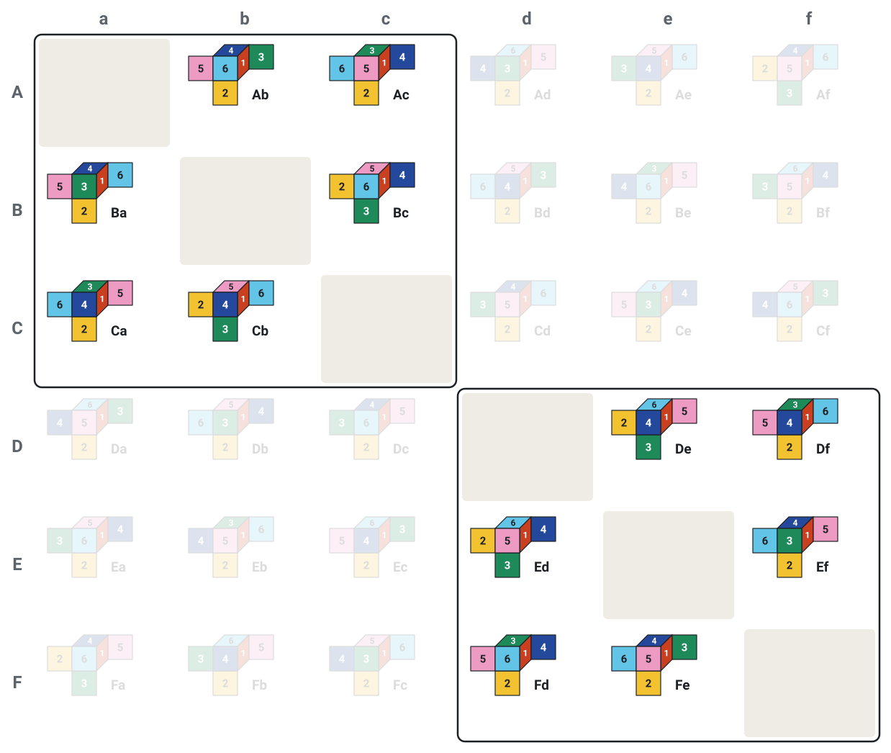

# The ten minimum universal sets of MacMahon cubes

- [Paper (PDF)](paper/macmahon-min-universal-sets.pdf) and [LaTeX](paper/macmahon-min-universal-sets.tex).
- [Main Lean results](MacMahon/Theorems.lean), [physical model](MacMahon/Definitions.lean), and [connection to corner matching](MacMahon/Geometry.lean).
- [Independent theorem statements](Challenge.lean) and [completed proof entry point](Solution.lean).
- [Provenance, scope and AI disclosure](formalization.yaml).

A MacMahon cube has six different face colours, one on each face. There are
30 varieties up to rotation; reflections remain distinct. A collection is
*universal* if, for every variety, eight cubes can be selected and assembled
into a 2×2×2 model with that variety's exterior colouring. Internal faces need
not match. A collection may contain repeated varieties.

[Haraguchi](https://arxiv.org/abs/1408.3696v2) showed that the minimum
collection size is **twelve** and gave a collection attaining it. We prove that
exactly **ten labelled collections** attain this minimum, even when repeated
varieties are allowed, and none of them has repeats. Colours are fixed, so
collections that differ only by a colour permutation count separately. This
resolves Johnson and Roldán's
[Conjectures 4 and 8](https://arxiv.org/abs/2407.13208v1) and extends their
conjectured classification to collections with repeated varieties. The minimum
and the classification are proved in Lean 4.

Conway's tableau names each variety by an ordered pair of distinct labels from
A–F. These labels are not colours. To obtain a minimum
collection, split the six labels into two triples and take one copy of each
variety whose two labels lie in the same triple. For example, `ABC | DEF`
selects the six ordered pairs within `ABC` and the six within `DEF`. Drawing
each pair as a directed edge gives **two disjoint triangles**, with both
directions present on every edge. The ten unordered partitions into triples
give exactly the ten minimum collections.



*The 30 varieties in Conway's tableau, each opened out as in Johnson and Roldán's
Figure 2. Digits are face colours; mirror-image varieties lie across the diagonal.*

## How the proof works

The proof records the number of copies of each variety in a six-by-six matrix.
Every target needs at least eight cubes that can fill one of its corner
positions. At total size twelve, the resulting inequalities force every row
and column sum to be two and the matrix
to be symmetric. The paper classifies the possible support graphs and uses
corner coverage to exclude all but two disjoint triangles. An explicit
construction proves that each triangle pair is universal.

Lean uses the same inequalities, then relabels the matrix to reduce its first
row to two possibilities: a doubled edge or two distinct neighbours. Corner
coverage excludes the doubled edge and forces the neighbours to close a
triangle; the degree equations determine the complementary triangle.
Sufficiency is checked using explicit constructions for all ten collections
and thirty targets.

All modules below are in [`MacMahon/`](MacMahon/):

| Part of the proof | Modules |
| --- | --- |
| Finite domains and geometric tables | `Types.lean`, `Data.lean` |
| Proper rotations and all 720 face-colour assignments | `Rotations.lean`, `Colourings.lean` |
| Equivalence of corner matching and physical face matching | `Geometry.lean` |
| Tableau incidence facts and necessary counting conditions | `Incidence.lean`, `Counting.lean` |
| Minimum bound, row and column sums, and symmetry | `Arithmetic.lean`, `Structure.lean` |
| The ten candidates and their complete classification | `Partitions.lean`, `Classification.lean` |
| The 300 construction certificates and their verification | `WitnessData.lean`, `Witness.lean` |
| Main theorems and submission interface | `Theorems.lean`, `Submission.lean` |

An inventory, defined in `Types.lean`, records the number of physical copies of
each variety. `Definitions.lean` defines corner matching and physical
constructions. Every construction assigns eight distinct copies to the eight
positions, with a proper rotation chosen for each copy. The geometry is modelled
using the six coordinate face directions and finite rotation tables.

The paper also reports exhaustive target-count histograms for sets of 8–13
distinct varieties, including the minimum size for exactly 29 targets. Those
computational results are not Lean theorems. Saved data are in
[`results/cubes/`](results/cubes/); reproduction commands appear below.

## Build and verification

For the Lean checks, install [Elan](https://github.com/leanprover/elan), Make,
Python 3 and Ruby. Run these commands from the repository root:

```sh
lake exe cache get
make check
```

Lean 4.35.0 and mathlib v4.35.0 are pinned in `lean-toolchain` and
`lake-manifest.json`.

| Command | Purpose | Also needs |
| --- | --- | --- |
| `make check` | Build Lean, audit axioms, check metadata and reproduce generated Lean sources | |
| `make comparator` | Compare the proofs against independent theorem statements and check them with Lean, NanoDa and con-ron | Linux and bubblewrap |
| `make paper` | Rebuild the paper PDF (optional) | LaTeX and latexmk |

`make check` also checks module headers and compares the axiom audit with its
expected output in `validation/`. `sorry` warnings from `Challenge.lean` are
expected. `make check` does not run the comparator.

`MacMahon.lean` contains guarded axiom audits. The proof library contains no
`sorry`, `admit`, custom axioms or `native_decide`; only `propext`,
`Classical.choice` and `Quot.sound` are permitted. Finite computations use
`decide +kernel`. The arithmetic tactics produce proof terms for the kernel.

## Reproduce the computational artifacts

To check the saved results and regenerate the geometric data and construction
certificates, run:

```sh
python3 scripts/verify_cubes.py
```

This checks the geometric model, candidate collections, saved histogram
accounting and example constructions. It reads the saved enumeration results;
it does not rerun the exhaustive enumeration. It rewrites the derived files
`geometry.json`, `corner_partitions.tex`, `universal_witnesses.json`,
`extremal_witnesses.json` and `verification.json` under `results/cubes/`.

To rerun both enumeration algorithms for every reported size, 8–13, install a
C++20 compiler with OpenMP support (the Makefile defaults to `g++`), then run:

```sh
make cubes
for k in 8 9 10 11 12 13; do
  python3 scripts/run_cube_experiment.py --k "$k" --threads 8 --histogram --selftest \
    --output "results/cubes/k${k}.json" || break
  python3 scripts/run_cube_experiment.py --k "$k" --threads 8 --histogram \
    --matching-tables --output "results/cubes/k${k}-matching.json" || break
done
python3 scripts/verify_cubes.py
```

Adjust `--threads` to suit the machine. For size 12 only, use `for k in 12`.
Each run replaces its output JSON file and appends
a provenance record to `results/cubes/experiments.jsonl`. Graph and matching
runs share the outer enumeration and tableau; the geometric checker is separate.

After regenerating the geometric data and construction certificates, regenerate
and check the Lean constants with:

```sh
make regenerate
make check
```

Regeneration writes `MacMahon/Data.lean` and `MacMahon/WitnessData.lean`.
Lean checks the correctness of their finite tables and construction witnesses;
the generator is not a trusted proof component.

To redraw the cube figure, run `python3 scripts/generate_cube_figure.py`.

## Palomar submission interface

The submission layout follows
[PalomarTemplate](https://github.com/PalomarRegistry/PalomarTemplate).

`Challenge.lean` imports only mathlib and defines its own physical model and
finite geometric tables. It states the ten main theorems, without proofs.
`Solution.lean` imports the completed proofs under the same names.

The comparator targets are:

| Result | Declaration in `MacMahon` |
| --- | --- |
| Minimum 12, attained | `minimum_size` |
| Lower bound for every universal inventory | `physical_minimum` |
| Exactly ten labelled minima | `physical_exactly_ten` |
| Two-triangle characterisation | `physical_iff_two_triangles` |
| No repeated varieties at the minimum | `physical_minimum_has_no_repeats` |
| Table equals all proper signed-axis rotations | `proper_rotation_iff` |
| Outward-face rule for the eight positions | `exposed_face_rule` |
| Each representative uses six distinct colours | `face_colours_valid` |
| Every six-colour face assignment is represented | `face_assignment_coverage` |
| Its variety and rotation are unique | `face_assignment_unique` |

For `make comparator`, dependencies under `.lake/packages` must be real
directories rather than symlinks outside the checkout. It adds the
independent-kernel settings to a temporary configuration; the submitted
`comparator.json` leaves these registry-owned settings unset.

The [manual preflight workflow](.github/workflows/palomar-preflight.yml) invokes
Palomar's reusable verifier at a pinned revision. Before submitting, commit the
reviewed snapshot, make it available on GitHub, run preflight on that exact
commit and use its full 40-character SHA in the
[Palomar submission form](https://submit.palomar-registry.org).
Preflight does not submit the project, and local verification does not constitute
registry acceptance.

## License and disclosure

Apache License 2.0; see [LICENSE](LICENSE). Cited sources and dependencies retain
their own licences. GPT-6-Astra (OpenAI), used through Codex, developed the
classification proof, computations, Lean formalisation and manuscript under the
author's direction. Claude Opus 5.5 (Anthropic), used through Claude Code, contributed
to paper review.

Automated checks are not independent human peer review. The literature search
was limited; publication priority has not been established by a comprehensive
review. Detailed provenance, review status and the distinction between formal
and computational claims are recorded in [formalization.yaml](formalization.yaml).

The human author initiated and directed the research and accepts responsibility
for the content of the paper and the accuracy of its disclosure.
